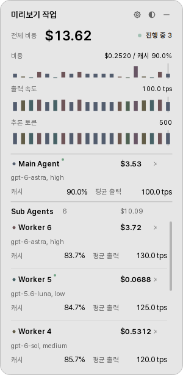

# CODEX, ON

[English](README.md) |  [한국어](README.ko.md)

**Codexon은 오버레이와 구독 모니터링을 중심으로 Codex 사용량을 확인하는 Windows 앱입니다. 지표 비교와 성능 추이에서 사용 기록을 분석합니다.**

- **호출 모델과 응답 모델의 불일치를 오버레이에서 바로 확인합니다.** 라우팅을 점검할 때 해당 호출의 요청 모델명과 응답 모델명을 나란히 살펴볼 수 있습니다.
- 작업 중 메인 에이전트의 누적 사용량과 하위 에이전트를 포함한 호출 추이를 오버레이에서 확인합니다.
- 오버레이에서 세션 기록을 열고 비교 결과에서 해당 호출 기록을 엽니다. 메인 사용량과 하위 에이전트 사용량을 구분해 확인합니다.
- 모델과 추론 강도를 함께 비교하고 프로젝트, 요청 모드, 입력 규모, 캐시 활용 구간별로 살펴봅니다. 미확인 항목은 기본으로 숨기며 **미확인 표시** 버튼으로 다시 표시합니다.
- 남은 사용량과 초기화 시각을 확인합니다. 대시보드를 닫아도 트레이와 작업표시줄 위젯에서 잔여량을 볼 수 있습니다.

금액은 **구독 가치 환산액**입니다. Standard 기준 토큰 단가에 구독 소모 배율을 적용하며, Fast는 같은 토큰 Standard 대비 2.5배입니다. [환산 기준](https://learn.chatgpt.com/docs/agent-configuration/speed). 모델 관찰은 요청/응답에 기록된 모델명을 비교합니다. 실시간 한도 조회는 설치된 Codex의 app-server와 계정 연결을 사용합니다.

설치 대상은 **Windows 10/11 x64**입니다. Python, Qt와 독립 연결 복구 도구가 설치 파일에 포함됩니다. Codex 계정 연결을 이용하며, Codexon을 위해 별도의 API 키를 발급할 필요는 없습니다.

## 호출 모델과 응답 모델이 다르다면

**선택한 모델과 응답에 기록된 모델이 같은지, 오버레이에서 확인하세요.** 불일치한 경우에만 모델과 추론강도 옆에 `(불일치: 응답 모델명)`을 표시합니다. Standard 이외의 요청 모드는 모델과 추론강도 뒤에 표시합니다.

라우팅을 점검할 때는 이 차이를 단서로 대시보드의 **호출 상세**에서 해당 기록을 확인할 수 있습니다. 비교 대상은 요청과 응답에 기록된 모델명이며, 내부 라우팅 경로나 실제 모델 구현을 확정하는 정보는 아닙니다.

## 실제 기록으로 보는 주간 사용 한도

**이전 기준 예시: 9월 29일 Pro x20 주간 할당량 환산 추정액은 약 $1,300입니다.**

아래 수치는 구독 Fast 2.5배 변경 이전 API 단가 기준 자료입니다. 2026년 9월 29일 19:49 KST 기준 실제 로컬 기록을 사용했습니다. 현재 주기의 로컬 관측 구간에서 API 환산액 **$246.96**, 한도 소모 **19%p**를 확인했으며, 주간 100% 기준 추정액은 **$1,299.80**입니다. 계정 전체 잔여량과 로컬 관측 구간의 소모량은 범위가 다르며, 차트는 관측 공백을 압축해 표시합니다.

홈에서 남은 사용량과 오늘 활동을 확인합니다. 각 기능의 설명을 읽고 구독 모니터링, 지표 비교, 성능 추이로 이동할 수 있습니다. 홈에서는 사이드바의 남은 사용량을 숨기며, 다른 화면에서는 다시 표시합니다.

## 오버레이 보기

합성 사용 기록으로 캡처한 화면입니다. 하위 에이전트 여섯 개 중 세 개를 표시하고 나머지는 목록을 스크롤해 확인합니다.

상단에서 전체 비용과 진행 요청 수를 확인합니다. 세 차트는 하위 에이전트를 포함한 최근 20호출의 비용, 출력 속도, 추론 토큰을 표시합니다. 선택한 호출의 캐시 적중률은 호출 비용 옆에 표시합니다. 에이전트 표식과 차트는 Codex 색상 설정에서 만든 같은 색상을 사용합니다.

**Main Agent**는 고정되어 있고 하단 **Sub Agents** 목록만 스크롤합니다. 각 행은 자체 누적 비용, 모델과 추론강도, 캐시 적중률, 평균 출력 속도를 표시합니다. 행을 펼치면 토큰 구성과 비용 산정 호출 수를 확인합니다.

헤더의 **설정** 버튼에서 차트 방식을 선택합니다. 하위 에이전트가 있으면 한 번에 표시할 개수를 1~4개로 정합니다. 높이는 표시 개수와 화면 공간에 맞춰 조절됩니다. 표시 개수는 대화별로 저장하며 재시작 후에도 유지합니다. 배경 투명도와 최소화 버튼도 사용할 수 있습니다. 최소화 아이콘을 누르면 다시 펼쳐집니다. 준비, 지연, 오류 상태는 상단의 진행 상태 자리에 표시합니다. 갱신이 원활하지 않을 때는 기존 값을 흐리게 표시합니다.

설치본을 교체하지 않고 변경한 화면을 확인하려면 [오버레이 미리보기](https://github.com/jisoq/Codexon/blob/main/docs/overlay-preview.md)를 실행하세요.

금액은 Standard 기준 단가와 Fast 2.5배를 적용한 구독 가치 환산액입니다. 모델 비교는 요청과 응답에 기록된 이름을 비교한 결과입니다.

## 시작하기

1. [Releases](https://github.com/jisoq/Codexon/releases)에서 `Codexon-Setup.exe`를 받습니다.
2. 설치 프로그램을 실행합니다. 관리자 권한이나 별도 Python 설치가 필요하지 않습니다.
3. 시작 메뉴에서 **Codexon**을 엽니다. 로그인 후에도 자동 실행하려면 **설정 → 일반 → Windows 로그인 시 시작**을 켭니다.

앱 내부 업데이트, 시작 메뉴 등록, 제거 기능을 갖춘 설치형으로 배포합니다.

Codex 기록이 아직 없다면 Codex를 먼저 사용한 뒤 대시보드를 갱신하세요. **설정 → 일반 → 언어**에서 한국어, English를 선택하면 다음 실행부터 적용됩니다. 대시보드를 닫아도 트레이에서 계속 실행되며, 완전히 종료하려면 트레이의 종료 메뉴를 사용합니다.

## 선택 기능: 출력 속도와 응답 모델 기록

**설정 → Codex 연결 → 출력 속도와 응답 모델 기록**을 켜면 로컬 프록시가 응답을 관찰합니다. 완료된 응답의 유효한 시간 기록으로 출력 속도를 계산하고, 요청 모델과 응답 모델을 비교합니다. 켤 때 모델 요청 없이 로컬 실행 상태를 확인합니다. 연결 설정을 변경한 뒤에는 Codex를 사용하는 앱이나 CLI를 한 번 재시작하세요. 이미 재시작했다면 반복할 필요가 없습니다. 세션 기록, 비용 분석, 사용 한도 화면은 프록시 없이도 사용할 수 있습니다.

완료된 요청과 응답을 신뢰할 수 있게 연결한 경우에만 모델 일치, 불일치를 표시합니다. 근거 누락이나 충돌은 불일치로 취급하지 않습니다. 응답에 기록된 모델명만으로 실제 처리 하드웨어나 내부 모델 구현까지 확인할 수는 없습니다.

### 프록시 추가 지연

제공된 측정 결과에서 프록시의 추가 시간 중앙값은 WebSocket 4KB에서 **0.16ms**, 256KB에서 **0.88ms**였습니다. 대용량 20MB에서는 WebSocket **70.91ms**, HTTP/SSE **40.12ms**로 측정됐습니다.

| 요청 조건 | 추가 시간 중앙값 | 95백분위 |
| --- | ---: | ---: |
| WebSocket 4KB | 0.16ms | 0.28ms |
| WebSocket 256KB | 0.88ms | 1.22ms |
| WebSocket 2MB | 8.39ms | 12.92ms |
| WebSocket 20MB | 70.91ms | 95.09ms |
| HTTP/SSE 20MB | 40.12ms | 65.63ms |

이는 프록시가 더한 시간이며 전체 응답 시간이나 모델 생성 시간이 아닙니다. 추가 지연이 0이라는 뜻은 아니며, 실행 환경과 전송 크기에 따라 달라질 수 있습니다.

## 업데이트와 연결 복구

Windows 오류 보고 기능에 GUI를 등록해 충돌이나 응답 중단 후 사용자가 재시작을 선택할 수 있습니다. 재시작하면 기존 데이터 경로를 유지하고 CPU 렌더링으로 대시보드를 엽니다. 별도 감시 프로세스는 추가하지 않습니다. 정상 종료와 설치 프로그램의 교체 과정에서는 등록을 해제합니다. 로그인 자동 시작 설정은 바꾸지 않습니다.

실행 후 60초가 지나야 Windows가 재시작을 제안하며, 시스템 정책에 따라 오류 창이 표시되지 않을 수 있습니다. 무인 자동 복구나 작업 관리자에서 강제 종료한 프로세스의 복구는 보장하지 않습니다. `Codexon.exe --software-rendering`으로 직접 실행할 수도 있습니다. CPU 렌더링에서는 성능과 일부 시각 효과가 달라질 수 있습니다. GUI가 충돌해도 별도 실행 중인 수집기와 프록시는 유지됩니다. Codexon을 정상 종료하면 관리 중인 서비스도 정리합니다.

**설정 → 앱 정보 → 업데이트 확인**에서 업데이트합니다. 연결 문제가 생기면 시작 메뉴의 **Codexon 연결 복구**를 사용하세요. 설정 → Codex 연결에서도 연결 복구를 열 수 있습니다.

트레이에서 종료하면 진행 중인 응답을 기다리는 안전 종료를 시작합니다. 실제 연결 정리를 시작하기 전에는 종료를 취소할 수 있습니다. 지원하는 프록시에서는 응답을 중단하고 종료하는 동작도 선택할 수 있습니다. 종료에 실패하면 앱을 계속 사용할 수 있고, 남은 연결 상태를 확인해 다시 시도할 수 있습니다.

ChatGPT만 종료해도 Codexon은 계속 실행됩니다. 언어 변경이나 앱 업데이트로 Codexon 화면을 교체할 때는 프록시와 수집기를 유지합니다. 업데이트가 연결 교체를 시작한 뒤에는 검증이나 복원이 끝날 때까지 기다립니다.

## 로컬 데이터와 제거

사용량 색인과 한도 이력은 `%LOCALAPPDATA%\CacheMonitor`에, 모델 관측 자료, 프록시 상태, 설정 백업은 `%USERPROFILE%\.cachemonitor\model-observer`에 저장됩니다. 이전 내부 이름은 호환성을 위해 유지합니다. 프로그램 업데이트나 제거만으로 이 기록을 삭제하지 않습니다.

**Windows 설정 → 앱 → 설치된 앱 → Codexon → 제거**를 사용합니다. 관리 중인 연결 설정을 먼저 복원하고, 사용 중인 구성요소가 있으면 제거를 보류합니다. 설정 백업에는 민감한 값이 포함될 수 있으므로 문제 신고에 백업이나 가리지 않은 기록을 첨부하지 마세요.

[보안 신고](SECURITY.md) |  [라이선스](LICENSE) |  [종속 라이브러리 고지](THIRD-PARTY-NOTICES.md).

Codexon은 별도 라이선스인 **Codexon Attribution License 1.0**을 사용합니다. 사용, 수정, 재배포는 허용하되, 원 제작자 **jisoq**와 원 저장소 **https://github.com/jisoq/Codexon**의 출처 표시를 보존해야 합니다. GUI가 있는 배포본은 설정, 정보 화면 등에도 이를 유지해야 합니다. 자세한 조건은 [LICENSE](LICENSE)에 있으며, 외부 구성요소에는 각자의 라이선스가 적용됩니다.
