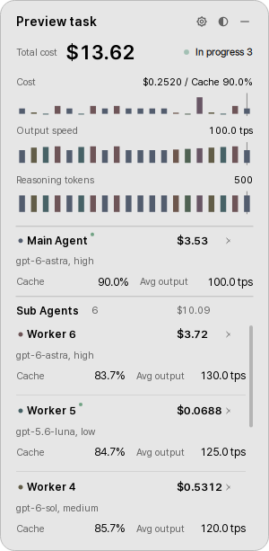

# CODEX, ON

[한국어](README.ko.md) |  [English](README.md)

**Codexon is a Windows app centered on the Codex overlay and subscription monitoring. Compare usage metrics and review performance trends from recorded calls.**

- **Spot a request/response model mismatch directly in the overlay.** Compare the requested and reported model names when investigating routing behavior.
- See the main agent's accumulated usage and call trends including subagents while working in Codex.
- Open session records from the overlay and call records from comparison results. Inspect main-agent and subagent usage separately.
- Compare model and reasoning effort together, grouped by project, request mode, input size, or cache utilization. Unknown entries are hidden by default; use **Show unknown** to include them.
- Follow remaining usage limits and reset times. The tray and taskbar widget keep them visible without opening the dashboard.

Amounts estimate subscription value using Standard base token rates and a 2.5x Fast usage multiplier; they are not billed charges. [Conversion basis](https://learn.chatgpt.com/docs/agent-configuration/speed). Model monitoring compares names recorded for a request and its response. Live limit checks use the installed Codex app-server and require an available account connection.

Supported installation target: **Windows 10/11 x64**. Setup includes Python, Qt and the independent connection recovery tool. Codexon can use your existing Codex account connection; no separate API key is required.

## Requested one model, got a different name back?

**Check the requested model against the model reported in the response, right in the overlay.** Only a mismatch adds `(mismatch: response model name)` after the model and reasoning effort. Request modes other than Standard also appear after the model and reasoning effort.

Use the difference as a clue when investigating routing behavior, then open **Call details** in the dashboard to inspect that call's record. These are recorded request/response names; they do not establish the internal routing path or underlying model implementation.

## Weekly allowance, measured from real usage

**Historical example: the September 29 Pro x20 weekly allowance estimate was about $1,300 under the previous conversion policy.**

These amounts use the previous API-rate conversion policy, before the subscription Fast 2.5x change. Calculated from real local records as of **September 29, 2026, 19:49 KST**. Locally observed intervals in the current cycle account for **$246.96** in value under the previous conversion policy and **19 percentage points** of allowance consumed, yielding **$1,299.80** when extrapolated to a full weekly allowance. Account-wide remaining allowance and locally observed consumption cover different scopes; observation gaps are compressed in the chart.

Home shows remaining usage and today's activity, with descriptions and links to subscription monitoring, metric comparison, and performance trends. The sidebar usage card is hidden on Home and returns on other screens.

## Overlay views

Captured with synthetic usage records. Three of the six subagents are visible at once; scroll the list to see the rest.

The top summary shows total cost and active requests. Three charts show cost, output speed, and reasoning tokens for the 20 most recent calls, including subagents. The selected call's cache hit rate appears beside its cost. Agent markers and charts share colors derived from Codex appearance settings.

**Main Agent** stays fixed while only the **Sub Agents** list below it scrolls. Each row shows its own cumulative cost, model and reasoning effort, cache hit rate, and average output speed. Expand a row to inspect token composition and the number of priced calls.

Open **Settings** in the header to choose bars or a filled line. When subagents are present, choose how many to show at once, from one to four. The height fits that count and the available screen space. Each conversation's count preference survives restarts. Separate controls adjust background transparency and minimize the overlay. Select the minimized icon to restore it. Preparation, delay, and error messages replace the activity status at the top. Existing values are dimmed when updates are interrupted or delayed.

Run the [overlay preview](https://github.com/jisoq/Codexon/blob/main/docs/overlay-preview.md) to try source changes without replacing the installed application.

Amounts use Standard base rates weighted by subscription usage: Fast is 2.5x Standard for the same tokens. Model comparison reflects recorded request/response names.

## Get started

1. Download `Codexon-Setup.exe` from [Releases](https://github.com/jisoq/Codexon/releases).
2. Run Setup. No administrator rights or separate Python installation are required.
3. Open **Codexon** from Start. Enable **Settings → General → Starts when you log in to Windows** if you want it available after login.

Codexon is distributed as an installer, with in-app updates, Start-menu shortcuts and uninstall support.

The dashboard reads local Codex records. If there are no records yet, use Codex first and refresh the dashboard. In **Settings → General → Language**, choose English or 한국어; the selection takes effect on the next launch. Closing the dashboard keeps Codexon in the tray. Use the tray's Exit action to stop it.

## Optional model monitoring

Enable **Settings → Codex connection → Compare requested and response models** to compare the requested and reported response model. Turning it on checks local readiness without sending a model request. Once setup succeeds, restart the app or CLI where you use Codex to apply the connection change. Session history, cost analysis and usage-limit views can be used without the proxy.

Codexon reports a model match or mismatch only when completed request/response evidence can be linked reliably. Missing or conflicting evidence is not treated as a mismatch. The reported model name does not prove which hardware or internal model implementation handled the request.

### Proxy latency overhead

In the supplied measurements, median proxy overhead was **0.16ms** for a 4KB WebSocket request and **0.88ms** for 256KB. At 20MB, median overhead was **70.91ms** over WebSocket and **40.12ms** over HTTP/SSE.

| Request condition | Median added time | 95th percentile |
| --- | ---: | ---: |
| WebSocket 4KB | 0.16ms | 0.28ms |
| WebSocket 256KB | 0.88ms | 1.22ms |
| WebSocket 2MB | 8.39ms | 12.92ms |
| WebSocket 20MB | 70.91ms | 95.09ms |
| HTTP/SSE 20MB | 40.12ms | 65.63ms |

These figures describe time added by the proxy, not total response time or model generation time. Overhead is not zero and can vary with the environment and transfer size.

## Updates and recovery

On Windows, Codexon registers the GUI with Windows Error Reporting for user-approved restart after a crash or hang. A restart opens the dashboard with CPU rendering and the same data locations, without adding a watchdog process. Normal exit and installer handoff remove the registration. This does not change login startup preferences.

Windows only offers this restart after at least 60 seconds of runtime, and system policy can suppress the error dialog. It does not guarantee unattended recovery or recover a process terminated through Task Manager. You can also launch `Codexon.exe --software-rendering` manually. CPU rendering can change performance and some visual effects. A GUI crash leaves the independently running collector and proxy available; exiting Codexon normally still stops its managed services.

Use **Settings → About → Check for updates**. For connection problems, open **Codexon Connection Recovery** from Start. You can also open recovery from Settings → Codex connection.

## Local data and removal

Codexon stores its usage index and quota history under `%LOCALAPPDATA%\CacheMonitor`, and model evidence, proxy state and configuration backups under `%USERPROFILE%\.cachemonitor\model-observer`. The older internal names are retained for compatibility. Updating or removing the program does not erase these records.

Use **Windows Settings → Apps → Installed apps → Codexon → Uninstall**. Removal restores the managed connection setting and defers deletion if app components are still in use. Configuration backups can contain sensitive values; do not attach them or unredacted records to bug reports.

[Security reporting](SECURITY.md) |  [License](LICENSE) |  [Third-party notices](THIRD-PARTY-NOTICES.md).

Codexon uses the custom **Codexon Attribution License 1.0**. Use, modification, and redistribution are permitted while preserving the original author **jisoq** and the original repository **https://github.com/jisoq/Codexon**, including their attribution in distributed graphical interfaces. See [LICENSE](LICENSE) for the full terms; third-party components retain their own licenses.
